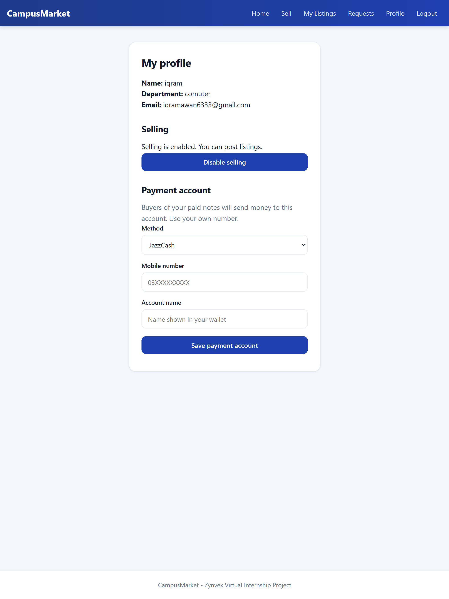
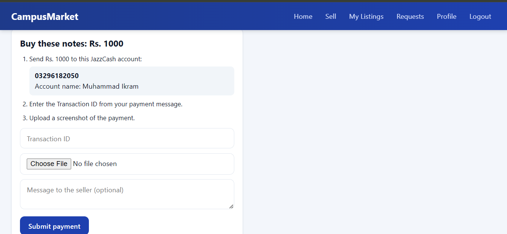
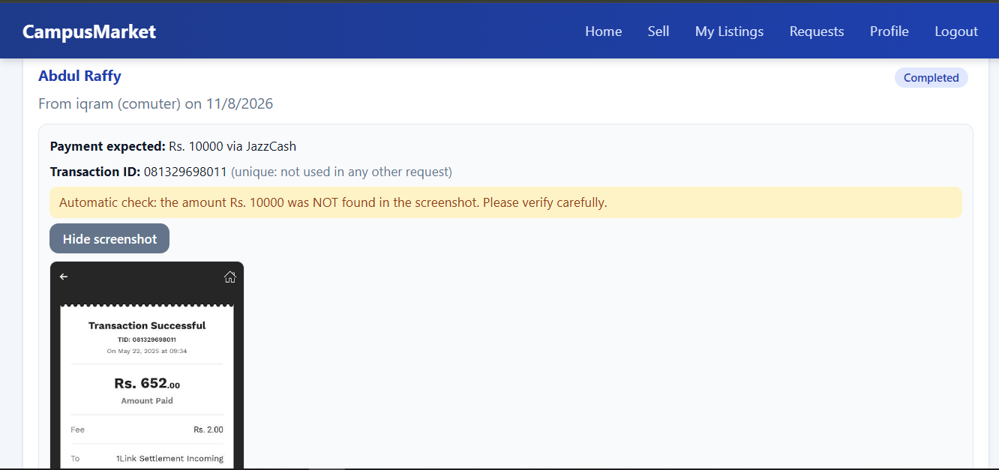
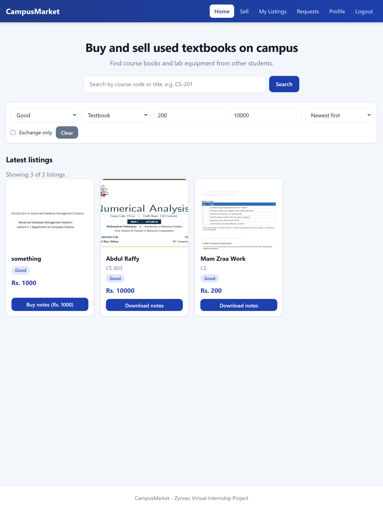
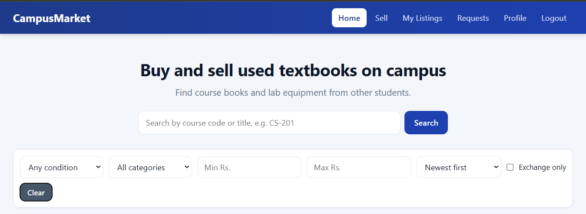
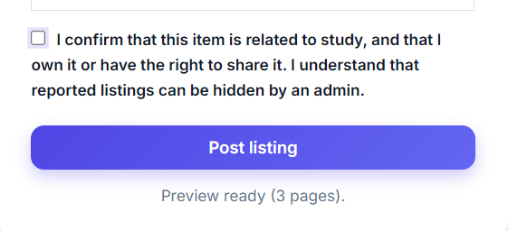
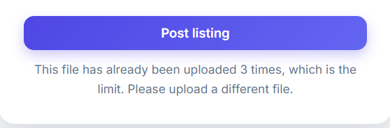
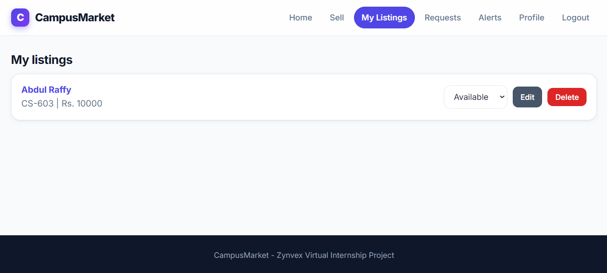

# CampusMarket

A student-to-student marketplace for buying, selling and exchanging used course textbooks, lecture notes and lab equipment.

**Zynvex Solutions Virtual Internship, Batch 5**
**Project:** WEB-01 CampusMarket: Student-to-Student Used Textbook Marketplace
**Intern:** Muhammad Iqram | **Internship ID:** ZYNVEX-CERT-2078 | **Track:** Web Development

**Live site:** https://muhammadiqram633.github.io/campusmarket/

## Problem

Students struggle to find affordable used textbooks and lab equipment, and there is no trusted campus-only place to buy, sell or exchange them. CampusMarket gives students one place to list items, search by course code, and contact each other, with a moderation tool for the student council.

## Tech stack

- **Frontend:** HTML, CSS and JavaScript
- **Backend:** Supabase (PostgreSQL database, authentication and file storage)
- **PDF previews:** pdf.js (runs in the browser)
- **Payment screenshot check:** Tesseract.js OCR (runs in the browser)
- **Hosting:** GitHub Pages (free)

## Project plan

| Module | Dates | Focus | Status |
|---|---|---|---|
| Module 1 | Oct 26 - Nov 01 | Setup, database design, authentication | Completed |
| Module 2 | Nov 02 - Nov 08 | Listings, requests, payments | Completed |
| Module 3 | Nov 09 - Nov 15 | Search, filters, safety reporting, polish | Completed |
| Module 4 | Nov 16 - Nov 22 | Testing, deployment, documentation | Planned |

## Module 1: what was completed

1. **Project setup:** project folder with HTML, CSS and JavaScript files, and a GitHub repository with regular commits.
2. **Base user interface:** responsive pages (home, login, register) that share one stylesheet and one navigation bar.
3. **Database design:** five related tables created in Supabase (see below).
4. **Database security:** Row Level Security enabled on every table, with rules that limit what each user can do.
5. **Authentication:** user registration and login using Supabase Auth, with the user profile saved to the database.

### Database design

The database is relational (PostgreSQL). Tables are connected with foreign keys, so data stays consistent.

| Table | Main fields | Purpose |
|---|---|---|
| `profiles` | id, full_name, department, role, is_seller, created_at | User details linked to the login account. Role is `student` or `admin` |
| `listings` | id, seller_id, title, course_code, category, condition, price, exchange_only, description, status, file_path | Textbooks, notes and lab equipment posted by students |
| `listing_images` | id, listing_id, image_url | Preview images of each listing |
| `requests` | id, listing_id, buyer_id, message, meeting_note, status, transaction_id, proof_path, amount, proof_check | Buyer-seller requests and payment details |
| `reports` | id, listing_id, reporter_id, reason, details, status | Safety reports reviewed by an admin |
| `payment_accounts` | user_id, method, account_number, account_name | Seller's JazzCash or EasyPaisa account |

Validation rules are enforced by the database itself:

- `condition` can only be `new`, `like_new`, `good` or `fair`.
- `status` values are restricted for listings, requests and reports.
- `price` cannot be negative.
- A buyer can have only one pending request per listing (unique index).
- A payment Transaction ID can be used only once (unique index).
- An index on course code prepares the search feature for Module 3.
- Deleting a user or listing also removes its related data (`on delete cascade`).

The complete SQL is in [`database/schema.sql`](database/schema.sql).

### Security (Row Level Security)

| Table | Rules |
|---|---|
| `profiles` | Everyone can view profiles. A user can create and update only their own profile, and cannot make themselves an admin. |
| `listings` | Everyone can view available listings. Only sellers can create listings, and a seller can edit and delete only their own. Hidden listings are visible only to the seller and admins. |
| `listing_images` | Everyone can view. Only the owner of the listing can add or delete images. |
| `requests` | Only the buyer and the seller of the listing can view a request. A buyer cannot send a request on their own listing. Only the seller can update the status. |
| `reports` | Any logged-in user can submit a report. Only admins can view and update reports. |
| `payment_accounts` | Logged-in users can view accounts. A user can change only their own. |

### Authentication flow

1. **Register:** the user fills in the form. `supabase.auth.signUp()` creates the account, then the user's full name and department are saved in the `profiles` table.
2. **Login:** `supabase.auth.signInWithPassword()` checks the email and password, then the user is redirected to the home page.
3. Errors (for example a wrong password) are shown in a message under the form.

The Supabase project URL and the publishable (anon) key are used in `js/supabaseClient.js`. The publishable key is designed to be public. Data is protected by Row Level Security, and no secret keys are stored in this repository.

## Module 2: listings, requests and payments (completed)

### Features

- **Seller mode:** new users start as buyers. A user enables selling on the Profile page after accepting the selling rules (study-related material that they have the right to share). The database also blocks listings from accounts that are not sellers.
- **Sell page:** logged-in sellers post a listing (title, course code, category, condition, price or exchange-only, description) with form validation.
- **Live listings:** the home page loads listings from the database as cards, with images loaded lazily for speed.
- **Automatic PDF previews:** when a seller uploads a PDF, the first 3 pages are converted to images in the browser (pdf.js) and shown publicly as a preview. Photos (JPG, PNG, WebP) can be uploaded for physical items.
- **Private file storage:** the full PDF is saved in a private Supabase Storage bucket. Only the seller, or a buyer whose request was accepted, can read it. This is enforced by storage policies in the database, not only by the interface.
- **Listing detail page:** preview pages, description, condition, price and seller details.
- **Buttons on every card:** Buy notes, Get notes, Download notes or Request item, depending on the listing and the user.
- **My Listings:** sellers change the status of a listing (available, reserved, sold) or delete it.
- **Requests page:** sellers see the requests they received and accept, decline or complete them. Buyers follow the status of the requests they sent.
- **Role-based navigation bar:** Login and Register for visitors, Logout, Requests and Profile for users, and My Listings only for sellers. If a buyer presses Sell, a popup asks them to enable selling first.
- **Responsive theme:** one stylesheet with a mobile layout. Heavy libraries (pdf.js and Tesseract.js) load only when they are needed.

### How payment works (no payment gateway)

The platform never handles money. Payment goes directly from buyer to seller through JazzCash or EasyPaisa.

1. The seller saves a JazzCash or EasyPaisa number in their Profile.
2. On a paid PDF listing, the buyer sees the seller's account details and the price.
3. The buyer pays, then enters the Transaction ID and uploads a screenshot of the payment.
4. The browser reads the screenshot (Tesseract.js OCR) and looks for the listing price. If the amount is found, the request is accepted at once and the download opens. If not, the request waits for the seller.
5. The seller sees the amount expected, the Transaction ID, the screenshot and the result of the automatic check. The seller can accept, or press **Payment not received**, which removes the buyer's access to the file.

Safety rules in the database:

- A Transaction ID can be used only once.
- Payment requests are created through a database function (`submit_payment_request`) that checks the listing, the price, the seller's account and the screenshot on the server side. A buyer cannot accept their own request.
- Payment screenshots are stored in a private bucket. Only the buyer and the seller of that listing can open them.

### Limitations

- The screenshot check is only an estimate. A real payment cannot be verified without access to the seller's wallet or a paid payment API, so the seller must confirm the money in their own JazzCash or EasyPaisa app. The **Payment not received** button exists for this reason.
- Study-related content is controlled through the seller rules, the report tool planned for Module 3, and admin review.

## Module 3: search, filters and safety (completed)

### Features

- **Search:** visitors search by course code (partial codes such as "CS" work), title and description. Results update while typing, and the search is not case sensitive.
- **Filters and quick chips:** condition, category, price range and exchange-only, with quick chips for Textbooks, Lab equipment, PDF notes and Exchange only. Advanced filters open from a Filters button that shows how many are active.
- **Sorting and paging:** newest first, price low to high, price high to low. Listings load 12 at a time with a counter and a Load more button, and skeleton cards are shown while loading.
- **In-app notifications:** sellers get a live popup and a counter when someone sends a request or payment, and buyers are notified when a request is accepted, declined or completed. Notifications are created by database triggers, so they cannot be faked.
- **Report button:** any logged-in user can report someone else's listing (scam, wrong information, inappropriate, copyrighted material, not study related, other), once per listing.
- **Admin page:** admins review reports and hide, dismiss or restore listings. The seller is notified when a listing is hidden, and only an admin can restore it. Admin rights are stored in the database and checked by it.
- **Copyright confirmation:** every new listing needs a tick confirming that the item is study related and that the seller has the right to share it. The database rejects a listing without it.
- **Upload limit for the same file:** the browser calculates a SHA-256 fingerprint of each PDF, and the same PDF can be uploaded at most 3 times. A database trigger enforces the limit.
- **Edit listing:** sellers change the title, course code, category, condition, price and description of their own listings.
- **New design:** a new responsive theme with a hero section, listing cards that show the course code on a colored background, a two-column listing page, and a role-based navigation bar that highlights the current page.

### Limitations

- The upload limit catches only identical files. A PDF with even a small change has a different fingerprint.
- Study-related content cannot be checked fully automatically. It is handled by the seller confirmation, user reports and admin review.
- Notifications work inside the website only. Email or phone alerts would need a server or a paid service.
- The payment screenshot check is an estimate, and the seller confirms the real payment in their JazzCash or EasyPaisa app.

### Future work

- Exchange flow where a buyer offers their own notes in return
- Email notifications
- Replace the uploaded file of an existing listing

## Project structure

```
campusmarket/
  index.html               home page: search, chips, filters, listings
  listing.html             listing detail, buy, request and report
  create-listing.html      sell page
  edit-listing.html        edit a listing
  my-listings.html         seller dashboard
  requests.html            requests received and sent, payment review
  notifications.html       notification list
  profile.html             profile, seller mode, payment account
  admin.html               report review for admins
  login.html
  register.html
  css/
    style.css
  js/
    supabaseClient.js      connects the website to Supabase
    auth.js                login check for protected pages
    nav.js                 navigation bar, seller popup, notifications
    register.js
    login.js
    home.js                search, filters, cards, downloads
    listing.js             detail page, payment box, OCR check, report
    create-listing.js      sell form, PDF previews, file fingerprint
    edit-listing.js
    my-listings.js
    requests.js
    notifications.js
    profile.js
    admin.js
  database/
    schema.sql             tables, validation rules, storage, triggers and security policies
  images/
  screenshots/             screenshots used in this README
  README.md
```

## Run locally

1. Clone the repository: `git clone https://github.com/MuhammadIqram633/campusmarket.git`
2. Open the folder in VS Code.
3. Start it with the Live Server extension (right-click `index.html`, then "Open with Live Server").

## Screenshots

### Module 1

#### Home page (sample cards)


#### Register page


#### Login page


#### Database tables in Supabase


#### Registered user in Supabase Authentication


### Module 2

<!-- Remove these comment markers once all these files are in the screenshots folder.

#### Home page with live listings


#### Listing detail page


#### Sell page


#### Profile with seller mode and payment account


#### Buyer payment box


#### Seller reviewing a payment request


#### Storage buckets in Supabase


-->

### Module 3


#### Home page with hero, chips and listings


#### Search results for a course code


#### Filters panel


#### Notifications


#### Report a listing


#### Admin review page


#### Copyright confirmation on the Sell page


#### Upload limit for the same file


#### Edit listing



