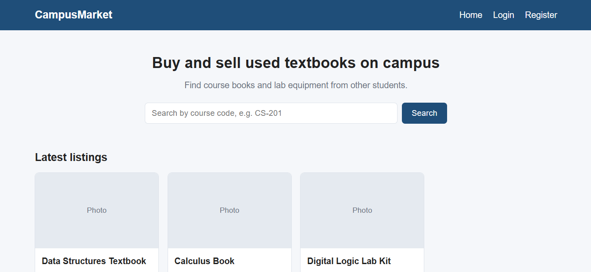
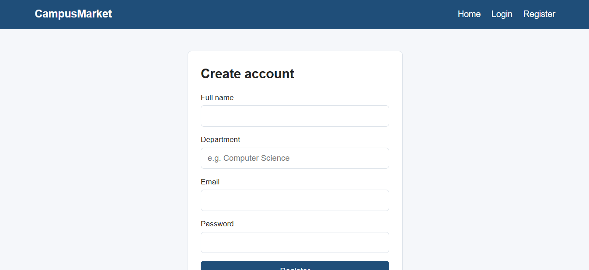
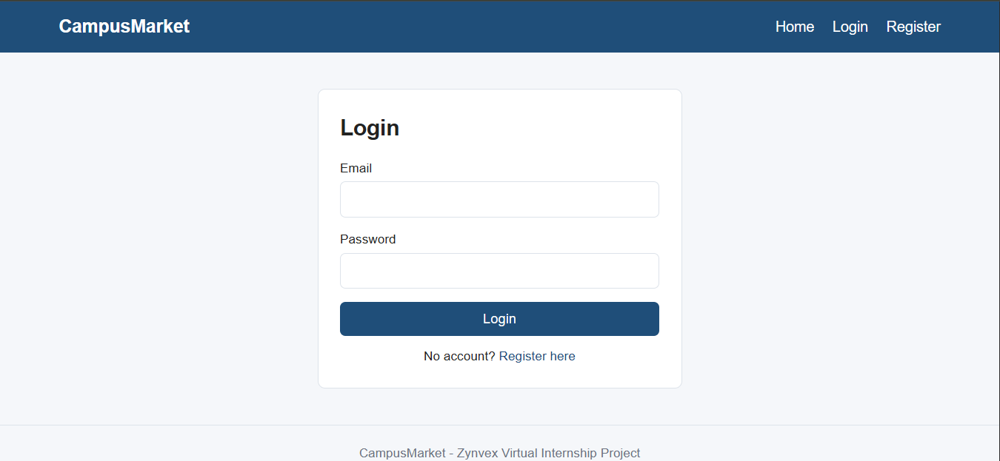
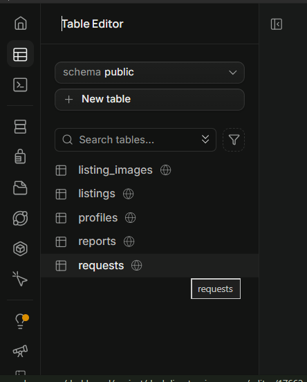
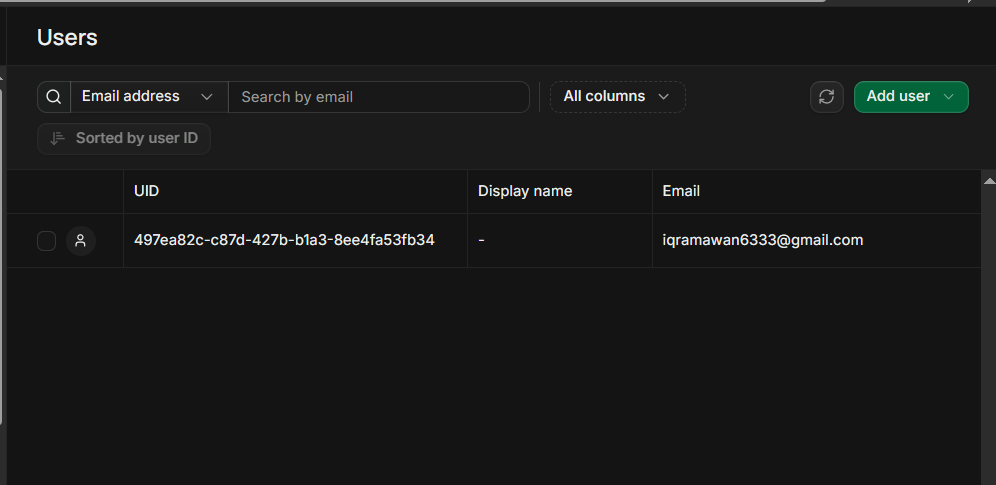

# CampusMarket

A student-to-student marketplace for buying, selling and exchanging used course textbooks and lab equipment.

**Zynvex Solutions Virtual Internship, Batch 5**
**Project:** WEB-01 CampusMarket: Student-to-Student Used Textbook Marketplace
**Intern:** Muhammad Iqram | **Internship ID:** ZYNVEX-CERT-2078 | **Track:** Web Development

## Problem

Students struggle to find affordable used textbooks and lab equipment, and there is no trusted campus-only place to buy, sell or exchange them. CampusMarket gives students one place to list items, search by course code, and contact each other, with a moderation tool for the student council.

## Tech stack

- **Frontend:** HTML, CSS and JavaScript
- **Backend:** Supabase (PostgreSQL database, authentication, and later image storage)
- **Hosting:** Vercel (free tier), planned for later modules

## Project plan

| Module | Dates | Focus | Status |
|---|---|---|---|
| Module 1 | Oct 26 - Nov 01 | Setup, database design, authentication | Completed |
| Module 2 | Nov 02 - Nov 08 | Listings, image upload, buyer-seller requests | Planned |
| Module 3 | Nov 09 - Nov 15 | Search, filters, safety reporting, polish | Planned |
| Module 4 | Nov 16 - Nov 22 | Testing, deployment, documentation | Planned |

## Module 1: what was completed

1. **Project setup:** project folder with HTML, CSS and JavaScript files, and a GitHub repository with regular commits.
2. **Base user interface:** three responsive pages (home, login, register) that share one stylesheet and one navigation bar.
3. **Database design:** five related tables created in Supabase (see below).
4. **Database security:** Row Level Security enabled on every table, with rules that limit what each user can do.
5. **Authentication:** user registration and login using Supabase Auth, with the user profile saved to the database.

### Pages

| Page | File | Description |
|---|---|---|
| Home | `index.html` | Search bar and listing cards (sample data for now, real listings come in Module 2) |
| Register | `register.html` | Create an account with full name, department, email and password |
| Login | `login.html` | Log in with email and password |

### Database design

The database is relational (PostgreSQL). Tables are connected with foreign keys, so data stays consistent.

| Table | Main fields | Purpose |
|---|---|---|
| `profiles` | id, full_name, department, role, created_at | User details linked to the login account. Role is `student` or `admin` |
| `listings` | id, seller_id, title, course_code, category, condition, price, exchange_only, description, status | Textbooks and lab equipment posted by students |
| `listing_images` | id, listing_id, image_url | Photos of each listing |
| `requests` | id, listing_id, buyer_id, message, meeting_note, status | Buyer-seller requests (pending, accepted, declined, completed) |
| `reports` | id, listing_id, reporter_id, reason, details, status | Safety reports reviewed by an admin |

Validation rules are enforced by the database itself:

- `condition` can only be `new`, `like_new`, `good` or `fair`.
- `status` values are restricted for listings, requests and reports.
- `price` cannot be negative.
- A buyer can have only one pending request per listing (unique index).
- An index on course code prepares the search feature for Module 3.
- Deleting a user or listing also removes its related data (`on delete cascade`).

The complete SQL is in [`database/schema.sql`](database/schema.sql).

### Security (Row Level Security)

| Table | Rules |
|---|---|
| `profiles` | Everyone can view profiles. A user can create and update only their own profile, and cannot make themselves an admin. |
| `listings` | Everyone can view available listings. A seller can create, edit and delete only their own listings. Hidden listings are visible only to the seller and admins. |
| `listing_images` | Everyone can view. Only the owner of the listing can add or delete images. |
| `requests` | Only the buyer and the seller of the listing can view a request. A buyer cannot send a request on their own listing. Only the seller can update the status. |
| `reports` | Any logged-in user can submit a report. Only admins can view and update reports. |

### Authentication flow

1. **Register:** the user fills in the form. `supabase.auth.signUp()` creates the account, then the user's full name and department are saved in the `profiles` table.
2. **Login:** `supabase.auth.signInWithPassword()` checks the email and password, then the user is redirected to the home page.
3. Errors (for example a wrong password) are shown in a message under the form.

The Supabase project URL and the publishable (anon) key are used in `js/supabaseClient.js`. The publishable key is designed to be public. Data is protected by Row Level Security, and no secret keys are stored in this repository.

## Project structure

```
campusmarket/
  index.html
  login.html
  register.html
  css/
    style.css
  js/
    supabaseClient.js    connects the website to Supabase
    register.js          registration logic
    login.js             login logic
  database/
    schema.sql           tables, validation rules and security policies
  images/
  screenshots/           screenshots used in this README
  README.md
```

## Run locally

1. Clone the repository: `git clone https://github.com/MuhammadIqram633/campusmarket.git`
2. Open the folder in VS Code.
3. Start it with the Live Server extension (right-click `index.html`, then "Open with Live Server"), or open `index.html` in a browser.

## Screenshots

### Home page


### Register page


### Login page


### Database tables in Supabase


### Registered user and profile saved in the database


## Next: Module 2 (Nov 02 - Nov 08)

- Create, view, edit and delete listings
- Image upload with Supabase Storage (JPG, PNG and WebP, size limit)
- "My Listings" page for sellers
- Buyer-seller request system with request log
